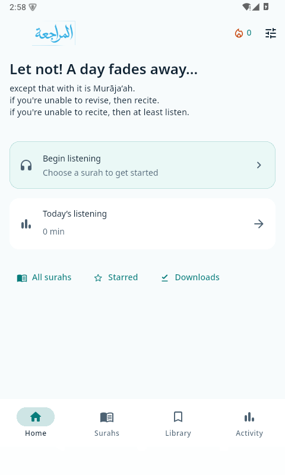
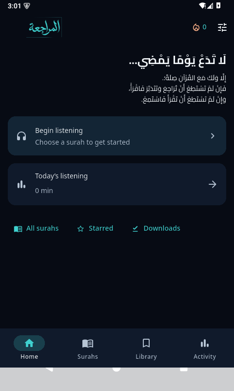
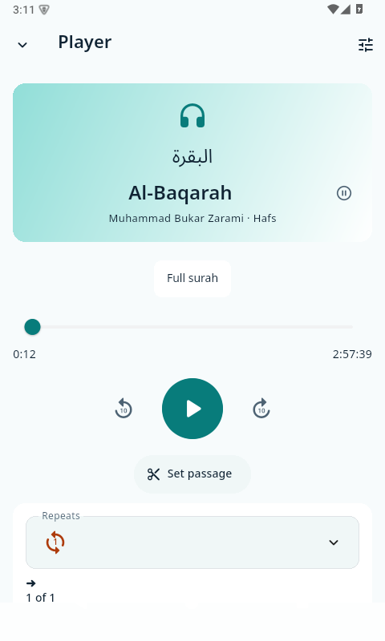
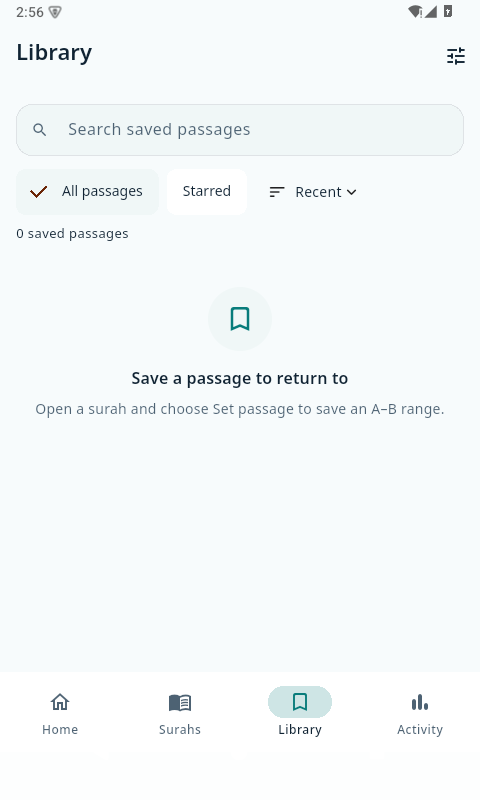

<p align="center">
  
</p>

<h1 align="center">Al-Murāja’ah</h1>

<p align="center"><strong>Listen. Repeat. Return.</strong></p>

<p align="center">
  Al-Murāja’ah helps you memorise and revise the Qur’an through listening. Choose a passage, repeat it, save it and return to it whenever you need. Stream recordings from the complete 114-surah Zarami/Hafs catalogue or download them for offline listening.
</p>

<p align="center">
  <a href="https://github.com/S-Adnan-11/al-murajaah/actions/workflows/android.yml"></a>
  <a href="https://github.com/S-Adnan-11/al-murajaah/releases/latest"></a>
  <a href="LICENSE"></a>
</p>

<p align="center">
  <a href="https://github.com/S-Adnan-11/al-murajaah/releases/tag/v1.0.1"><strong>Download</strong></a> ·
  <a href="https://github.com/S-Adnan-11/al-murajaah-feedback/issues"><strong>Feedback</strong></a> ·
  <a href="CONTRIBUTING.md"><strong>Contribute</strong></a>
</p>

<p align="center">Current Android release: <strong>1.0.1+36</strong>.</p>

<p align="center">
  
  
  
  
</p>

App screenshots captured from build 1.0.1+35 with a disposable profile and no personal saves. The current 1.0.1+36 release has the same interface.

## Install on Android

1. Open the [v1.0.1 release](https://github.com/S-Adnan-11/al-murajaah/releases/tag/v1.0.1) and download **Al-Murāja’ah.apk**. The adjacent **Al-Murāja’ah.apk.sha256** verifies that file’s bytes.
2. Allow your browser or file manager to install this APK when Android prompts you. No split installer is needed.
3. Open the downloaded APK and follow Android’s installation prompts. If you already have an earlier private test build, read the migration section below first.

The APK declares **Android 7.0 / API 24** as its minimum and includes ARM32, ARM64 and x86_64 libraries. This minimum is a build setting, not a claim of device coverage. Recordings download separately; they are not bundled with the installer.

The release APK is non-debuggable and uses a dedicated production signing certificate. Certificate SHA-256: `acac6c5bc482ea7c9246fd233fc59efe707b65779c40b17f9d663b3937f0737d`. Future production updates must retain the package and signer and increase the build number. This release is distributed directly through GitHub.

<details>
<summary>One-time migration from an earlier private test build</summary>

Android rejects an ordinary update from the previous debug-origin signer to the new production signer. Keep the old app until you have paused playback, exported through **Settings → Backup & restore → Export metadata backup**, received the saved-and-verified confirmation, and copied the JSON off the device to private storage. Verify the backup and keep a second copy before deciding to remove the old installation.

To migrate the same package, the owner must then manually remove the old test installation, install the production APK, select **Choose backup to import**, review its contents, enable **Apply settings from backup** if wanted, and import. Removing the old app erases its private data and downloads. Metadata restores passages, stars, listening records/best streak and supported preferences; recordings must be downloaded again. Playback checkpoints, transfer state, feedback drafts and discovery state do not transfer. Stop if backup verification fails; there is no automatic signer-migration path in this release.

</details>

Contributor debug builds use their own local development key and generally cannot update the distributed installation.

## What V1 does

- Browse and search the complete catalogue while the current playback session continues independently.
- Play full surahs or saved A–B passages, with finite total plays or Continuous, speed controls, passage gaps and a sleep timer.
- Create, edit, star and revisit passages in the Library; continue an existing session without browsing replacing it.
- Download recordings with byte-size and SHA-256 verification; reuse verified local audio offline and reconcile background Android transfers.
- Track credited listening time, daily goals, current listening streak and best streak.
- Use Light, Dark or System appearance, reduced motion and the alternating English/Arabic Home reminder, which can be frozen in the current language.
- Export and preview/import metadata backups, view credits and the origin story, and submit text feedback after reviewing its public-submission notice.

## Start revising

1. Open **Surahs**, choose a recording and press **Play**. Browsing another recording leaves the active session alone until you explicitly play it.
2. In the player, choose **Set passage**, set the A and B times, name the passage and choose repeat options. **Save** keeps current playback; **Save & play** starts the new passage at A.
3. Return to the passage from **Library**. For offline listening, download its recording and wait for verification to complete before disconnecting.

## Technology stack

<p>
  <a href="https://flutter.dev/"></a>
  <a href="https://dart.dev/"></a>
  <a href="https://kotlinlang.org/"></a>
  <a href="https://developer.mozilla.org/en-US/docs/Web/JavaScript"></a>
  <a href="https://developer.android.com/"></a>
  <a href="https://sqlite.org/"></a>
  <a href="https://cloudinary.com/documentation"></a>
  <a href="https://developers.cloudflare.com/workers/"></a>
  <a href="https://nodejs.org/"></a>
  <a href="https://gradle.org/"></a>
  <a href="https://docs.github.com/en/actions"></a>
</p>

### Mobile app and audio

| Technology | Actual role |
| --- | --- |
| Flutter / Dart | Material UI, app logic, asynchronous work and shared application source |
| Kotlin / Android APIs | Native MethodChannel adapters for DownloadManager transfers, document export/import, device details and diagnostics |
| audio_service | Background playback service, media notifications and system media controls |
| just_audio | Streaming/local playback, clipping, seeking and playback speed under one playback handler |
| audio_session | Audio-focus and interruption handling for the playback session |
| Riverpod | Shared dependencies and reactive provider composition |
| go_router | Application routes and navigation |
| SQL / Drift / sqlite3 / SQLite | Generated database access, local preferences, passages and listening activity, with versioned migrations |
| Swift / UIKit — prepared | iOS runner and limited support-channel source. iOS builds, native adapters and device behavior remain unverified; Xcode/macOS validation is pending |

### Media hosting and feedback

| Technology | Actual role |
| --- | --- |
| Cloudinary | HTTPS delivery of configured recitations for streaming and verified downloads |
| JavaScript / Cloudflare Workers | ES-module feedback endpoint, payload validation and public-issue relay |
| Cloudflare Durable Objects | Serialized quotas, deduplication and retry references in SQLite-backed storage; edge rate limiting supplements the relay |
| GitHub Issues REST API | Public feedback destination; the scoped token stays in Cloudflare Secrets |

### Build, testing and automation

| Technology | Actual role |
| --- | --- |
| Flutter SDK / Dart SDK / Pub | App commands, package resolution and the committed pubspec.lock |
| Gradle / Android Gradle Plugin / R8 | Kotlin DSL build configuration, Android packaging, R8 code shrinking and resource shrinking for releases |
| JDK / Android SDK / NDK / CMake | Android and native-dependency toolchain; JDK 21 runs builds, while Java/Kotlin bytecode targets JVM 17 |
| build_runner / drift_dev | Database access code, versioned schema sources and migration-test generation |
| Dart analyzer / formatter / flutter_lints | Static analysis, Dart formatting and configured lint rules |
| flutter_test / integration_test | Unit, widget and migration tests, plus bounded Android runtime checks with required fixtures |
| Node.js / node:test / node:assert/strict | Worker preparation scripts and mocked protocol/concurrency assertions |
| npm / Wrangler / Miniflare / workerd | Separate Worker tools, deliberate deployment and local runtime/SQLite Durable Object tests; installed under ignored artifacts |
| Git / GitHub Actions / Bash / Windows batch | SDK commit pinning, Android CI, mocked Worker tests and cross-platform Gradle launch scripts |

Pinned versions and copyable commands are in [Build and run](#build-and-run); Worker administration and runtime checks are in the [relay README](services/feedback-worker/README.md). The CI artifact is a debug APK; production signing and service deployment remain separate maintainer operations.

### Supporting packages and assets

- **Files and paths:** path_provider locates app storage; path joins and normalizes local paths.
- **Integrity:** crypto supplies SHA-256 verification for audio files and hashes for diagnostic exports.
- **Icons and typography:** Flutter Material Icons and the bundled Cairo / Noto Sans Arabic fonts supply UI icons and Arabic text. Their notices and the other asset permissions remain in [THIRD_PARTY_NOTICES.md](THIRD_PARTY_NOTICES.md).

## Build and run

Use the existing pinned toolchain; do not upgrade dependencies to prepare a release:

| Prerequisite | Version |
| --- | --- |
| Flutter | **3.47.5**, commit `6a19cca56475dbfba1478ee68d7bd0c2ef891da1` |
| Dart | **3.13.4**, bundled with that Flutter SDK |
| JDK | **21** |
| Android SDK | Platform **36**, Build Tools **36.0.0** |
| Android native tooling | NDK **28.2.13676358**, CMake **3.22.1** |
| Gradle / Android Gradle Plugin | **9.3.1** / **9.1.0**, configured in `android/` |
| Optional Worker tests | Node.js **22 or newer**; locally checked with **26.10.0** |

Install the pinned Flutter SDK, put its `bin` on PATH, and install JDK/Android SDK components. Accept Android SDK licences with `flutter doctor --android-licenses`. Set `JAVA_HOME` and configure Flutter for your local JDK and Android SDK if automatic discovery needs help:

```text
flutter config --jdk-dir YOUR_JDK_21_DIRECTORY --android-sdk YOUR_ANDROID_SDK_DIRECTORY
flutter doctor -v
git clone https://github.com/S-Adnan-11/al-murajaah.git
cd al-murajaah
flutter --version
flutter pub get --enforce-lockfile
dart run build_runner build
flutter analyze --no-pub
flutter test --no-pub
flutter build apk --debug --no-pub
flutter devices
flutter run -d DEVICE_ID
```

Replace the directory and device placeholders with your own observed values. Flutter generates ignored local SDK/plugin configuration. The repository supplies the Gradle wrapper, native project files, fonts/catalogue/brand assets, generated database sources and migration fixtures. Internet access is needed for initial SDK/dependency downloads. The development APK is `build/app/outputs/flutter-apk/app-debug.apk`.

The existing [CI workflow](.github/workflows/android.yml) shows the exact Flutter commit checkout and Android `sdkmanager` component commands. In `flutter run`, use the terminal’s hot-reload commands while developing and press `q` to end the run.

**No owner signing key, GitHub token or Cloudflare credential is needed to develop, test or build a debug APK.** Leave `android/production/key.properties` absent. The established application ID is `dev.almurajaah.al_murajaah.diagnostic`; avoid installing a differently signed development APK over personal data. Use an emulator or a separate test device/profile.

For local feedback UI testing, an optional compile-time `FEEDBACK_ENDPOINT` can point to an HTTPS `/feedback` endpoint you control:

```text
flutter run -d DEVICE_ID --dart-define=FEEDBACK_ENDPOINT=https://YOUR_WORKER_HOST/feedback
```

Without the define, feedback sending is unavailable; other development features remain usable. Do not use the production tracker for automated tests. The accepted release’s endpoint is public configuration, and all service credentials stay server-side. See [feedback relay setup and tests](services/feedback-worker/README.md).

Release builds intentionally require private `android/production/key.properties` and the approved production certificate. They fail without it; there is no fallback to development or legacy signing. A maintainer production update must retain package identity, use the same production signer and increase the build number beyond distributed builds. Private release keys, credentials and distribution artifacts are outside source history.

## Checks

The [Android workflow](.github/workflows/android.yml) resolves the lockfile, checks generated database code, analyzes Dart, runs unit/widget/migration tests and builds a debug APK. Its artifact is development build evidence. Worker protocol tests use mocked GitHub requests:

```text
node --test services/feedback-worker/test/relay.test.mjs
```

Native playback checks live in `integration_test/` and `test_driver/`. Read each check’s fixtures and bounds before running; some need private audio fixtures and are not a blanket fresh-checkout test suite. Keep existing installations and data intact. Use `--keep-app-running` when driving integration checks. Playback-state assertions do not establish audible quality.

## Architecture

| Area | Responsibility |
| --- | --- |
| `lib/main.dart`, `lib/app/` | Startup, shared dependencies, Riverpod composition and go_router routes |
| `lib/core/audio/` | One `PrototypeHandler` via audio_service/just_audio, audio-session handling, repeat/transport intent and diagnostic support |
| `lib/core/database/` | Drift/SQLite schema, migrations and persisted preferences/library/activity |
| `lib/core/theme/` | Shared theme, branding, Arabic typography and Home-language state |
| `lib/features/` | Catalogue, downloads, player/Library, activity, backup, settings and support screens |
| `android/` | Native media integration, DownloadManager/file verification and document adapters |
| `ios/` | Prepared native source/configuration; runtime adapters and verification remain incomplete |
| `assets/` | Immutable catalogue metadata, fonts/notices, approved brand artwork and credits portrait |
| `services/feedback-worker/` | Cloudflare Worker and SQLite Durable Object relay, sanitized deployment template and mocked tests |
| `test/`, `integration_test/`, `test_driver/` | Unit/widget/migration coverage and bounded Android runtime checks |

Browsing is separate from playback authority. Only explicit Play replaces the active session. Recording IDs, delivered byte hashes and saved time ranges are persistent contracts; replacing recording bytes requires a new identity rather than silently remapping existing saves.

## Data, downloads and backup

The app has no account or analytics service. Its database, saves, settings, listening history, support drafts and downloaded audio are local to the device. Network requests for streaming/downloads go to the configured media host; feedback passes through Cloudflare to public GitHub issues.

Verified downloads remain available offline. Full-file size and checksum validation protects downloaded audio; a stream is not fully hashed before it plays. New streams/downloads depend on hosting availability and capacity. Fresh/absent Wi-Fi-only settings default Off in this version; existing choices persist.

Metadata backup format 4 includes passages, stars, listening records, supported preferences and best streak, with older supported formats still readable. Backups exclude audio bytes, file paths, transfer state and playback checkpoints; they are not complete device images. Imports preview changes, preserve existing identities on conflicts and avoid duplicating existing events. Audio must remain on the device or be downloaded again. Treat backups as private because names and activity can reveal listening habits. Uninstalling or clearing app data can destroy local information.

## Platform and verification limits

Android is the distribution target. V1 has automated tests and bounded Android emulator/device evidence, with owner acceptance at the supplied scope. Minor crackling on Redmi 12C remains a known non-blocking issue; no acoustic cure is claimed. OEM background behavior, interruptions, TalkBack and long phone sessions still need broader verification. Physical battery drain and universal cold-start timing have not been established.

iOS sources, icons and configuration are prepared. No iOS build, signing, device compatibility or completed native download/document/power adapters are claimed. Building or validating iOS requires deliberate follow-up on macOS with Xcode.

## Troubleshooting

| Symptom | What to check |
| --- | --- |
| SDK, Java or licence error | Run `flutter doctor -v`; match the pinned toolchain, install the listed Android components and accept SDK licences |
| Release build refuses to sign | Expected without private distribution configuration. Use `--debug` for contribution; never substitute a new key for an existing installation |
| Feedback sending unavailable | Development builds omit the endpoint by default. Use your own test endpoint; production availability and token expiry are separate maintainer checks |
| Download fails verification | Keep the expected size/hash intact. Check connectivity and hosting; changed bytes require maintainer investigation, not bypassing verification |

## Contribute and give feedback

Interested developers, including Muslim developers, are welcome; participation is open to everyone. Read [CONTRIBUTING.md](CONTRIBUTING.md) for contribution scope and practical checks. Contributor pull requests belong in this source repository. User bug reports and suggestions belong in the separate [feedback repository](https://github.com/S-Adnan-11/al-murajaah-feedback).

## Licence and attribution

First-party source code is available under the [MIT licence](LICENSE), copyright **2026 S. Adnan**, for reuse, modification, forks and contributions. Third-party components and assets retain their own terms: see [THIRD_PARTY_NOTICES.md](THIRD_PARTY_NOTICES.md), the bundled font licences and [catalogue attribution](assets/catalog/ATTRIBUTION.txt).

Forks may retain the bundled Noto Sans Arabic and Cairo fonts under their OFL terms, including the copyright/licence notices, and chapter names/transliterations with the existing Tanzil attribution. Brand artwork (including launcher/splash icons and screenshots), the reciter portrait and recitations require the relevant rights holders’ permission before redistribution; otherwise replace or remove them in a distributed fork. Recording URLs are delivery configuration, not a redistribution grant. See the [asset permissions table](THIRD_PARTY_NOTICES.md#building-and-distributing-a-fork) for the boundaries.
