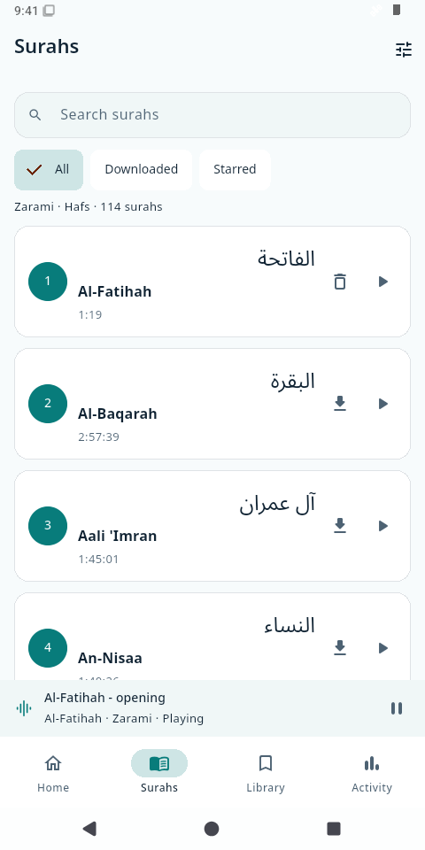
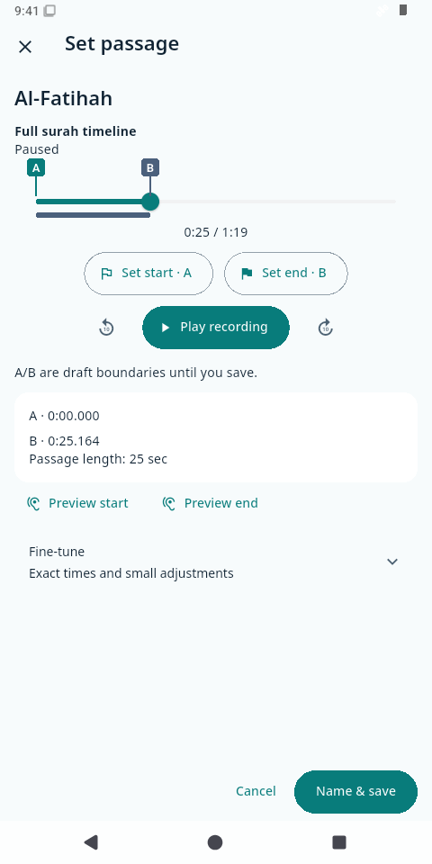
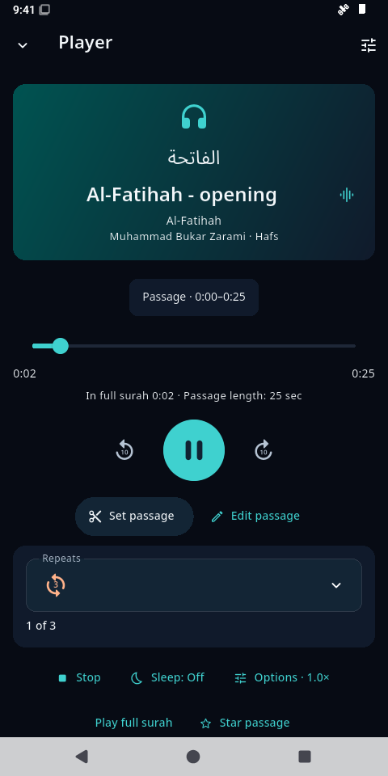
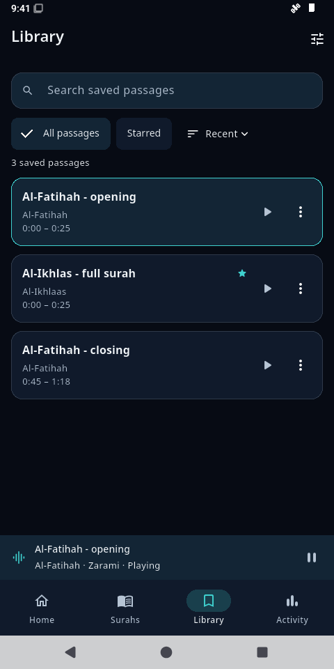
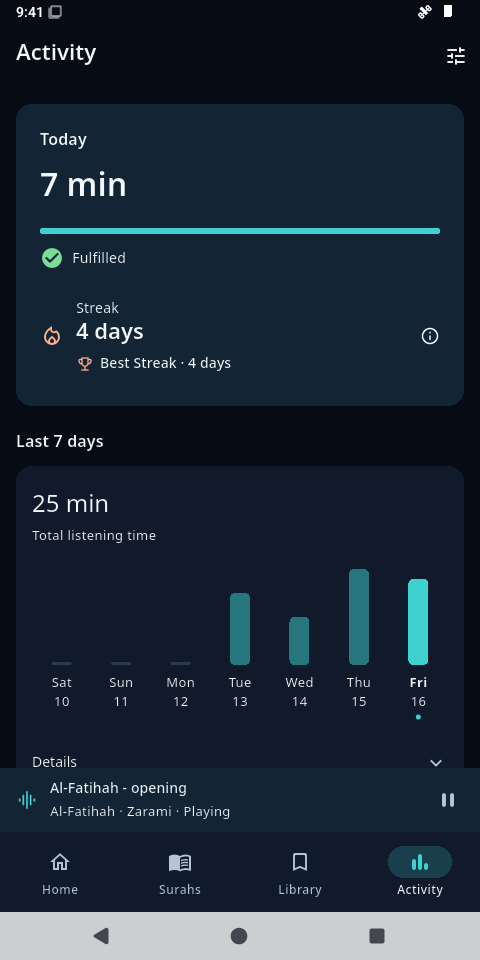

<p align="center">
  
</p>

<h1 align="center">Al-Murāja’ah</h1>

<p align="center"><strong>Listen. Repeat. Return.</strong></p>

<p align="center">
  Al-Murāja’ah helps you memorise and revise the Qur’an through listening. Choose a passage, repeat it, save it and return to it whenever you need. We built it with Flutter. Background playback and verified offline downloads support revision across the complete 114-surah Zarami/Hafs catalogue.
</p>

<p align="center">
  <a href="https://github.com/S-Adnan-11/al-murajaah/actions/workflows/android.yml"></a>
  <a href="https://github.com/S-Adnan-11/al-murajaah/releases/latest"></a>
  <a href="LICENSE"></a>
</p>

<p align="center">
  <a href="https://github.com/S-Adnan-11/al-murajaah/releases/latest"><strong>Download</strong></a> ·
  <a href="https://github.com/S-Adnan-11/al-murajaah-feedback/issues"><strong>Feedback</strong></a> ·
  <a href="CONTRIBUTING.md"><strong>Contribute</strong></a>
</p>

<p align="center">Current Android release: <strong>1.0.1+36</strong>.</p>

[Set up for development](#build-and-run) · [Architecture and contribution guide](CONTRIBUTING.md#how-the-app-fits-together) · [Checks](#checks)

## See it in action

<p>
  <strong>1. Choose a surah</strong> — Browse the catalogue and download a recording for offline revision.<br>
  <strong>2. Mark your passage</strong> — Seek and set A/B boundaries on the full-surah timeline.
</p>

<p align="center">
  <a href="screenshots/catalogue-light.png"></a>
  <a href="screenshots/passage-light.png"></a>
</p>

<p>
  <strong>3. Repeat and return</strong> — Play a named passage, then revisit your saved passages in Library.<br>
  <strong>4. Follow your progress</strong> — Review credited listening, your daily goal and listening streak.
</p>

<p align="center">
  <a href="screenshots/repeat-dark.png"></a>
  <a href="screenshots/library-dark.png"></a>
  <a href="screenshots/activity-dark.png"></a>
</p>

Captured from the released **1.0.1+36** APK on a disposable emulator. Passage names and listening history are demonstration data. Select any screenshot to view it at full size.

## What the app does

- Browse and search the complete catalogue while the current playback session continues independently.
- Play full surahs or saved A–B passages, with finite total plays or Continuous, speed controls, passage gaps and a sleep timer.
- Create, edit, star and revisit passages in the Library; continue an existing session without browsing replacing it.
- Download recordings with byte-size and SHA-256 verification; reuse verified local audio offline and reconcile background Android transfers.
- Track credited listening time, daily goals, current listening streak and best streak.
- Use Light, Dark or System appearance, reduced motion and the alternating English/Arabic Home reminder, which can be frozen in the current language.
- Export and preview/import metadata backups, view credits and the origin story, and submit text feedback after reviewing its public-submission notice.

## How it works

We use Flutter and Dart for the interface and application logic, with Riverpod for shared dependencies and go_router for navigation. Drift/SQLite stores passages, preferences and listening activity locally.

Playback runs independently of navigation. One `PrototypeHandler` coordinates just_audio and audio_service, so browsing another surah doesn't interrupt your session. Explicit Play starts a different session. Downloads are checked against the catalogue's byte size and SHA-256 before we use them offline.

| Part | Technology and role |
| --- | --- |
| Android integration | Kotlin adapters for DownloadManager, document import/export and device information |
| Audio delivery | Cloudinary HTTPS URLs for streaming and downloads; recording bytes are not bundled |
| Feedback | JavaScript on Cloudflare Workers, with SQLite Durable Objects for quotas and retry tracking; relays reviewed text to a separate public GitHub tracker |
| Tests and builds | Flutter tests, Drift migrations, Gradle and GitHub Actions; Node.js protocol tests and Miniflare/workerd runtime checks for the relay |
| Typography | Bundled Cairo and Noto Sans Arabic fonts, with notices in [THIRD_PARTY_NOTICES.md](THIRD_PARTY_NOTICES.md) |

Android is the released platform. The iOS runner and some support-channel code are present, but builds, native integrations and device behaviour still need macOS/Xcode and device testing. See [where contributions help](CONTRIBUTING.md#where-help-is-welcome).

## Install on Android

1. Open the [latest release](https://github.com/S-Adnan-11/al-murajaah/releases/latest) and download the APK and its matching `.sha256` file. Compare the APK’s SHA-256 with that file before installing.
2. Allow your browser or file manager to install this APK when Android prompts you. No split installer is needed.
3. Open the downloaded APK and follow Android’s installation prompts. If you already have an earlier private test build, read the migration section below first.

The APK declares **Android 7.0 / API 24** as its minimum and includes ARM32, ARM64 and x86_64 libraries. This minimum is a build setting, not a claim of device coverage. Recordings download separately; they are not bundled with the installer.

The release APK is non-debuggable and uses a dedicated production signing certificate. Certificate SHA-256: `acac6c5bc482ea7c9246fd233fc59efe707b65779c40b17f9d663b3937f0737d`. Future production updates must retain the package and signer and increase the build number. This release is distributed directly through GitHub.

<details>
<summary>One-time migration from an earlier private test build</summary>

Android rejects an ordinary update from the previous debug-origin signer to the new production signer. Keep the old app until you have paused playback, exported through **Settings → Backup & restore → Export metadata backup**, received the saved-and-verified confirmation, and copied the JSON off the device to private storage. Verify the backup and keep a second copy before deciding to remove the old installation.

To migrate the same package, manually remove the old test installation, install the production APK, select **Choose backup to import**, review its contents, enable **Apply settings from backup** if wanted, and import. Removing the old app erases its private data and downloads. Metadata restores passages, stars, listening records/best streak and supported preferences; recordings must be downloaded again. Playback checkpoints, transfer state, feedback drafts and discovery state do not transfer. Stop if backup verification fails; there is no automatic signer-migration path in this release.

</details>

Contributor debug builds use their own local development key and generally cannot update the distributed installation.

## Build and run

These versions match our Android CI. Use them for a reproducible starting point:

| Prerequisite | Version |
| --- | --- |
| Flutter | **3.47.5**, commit `6a19cca56475dbfba1478ee68d7bd0c2ef891da1` |
| Dart | **3.13.4**, bundled with that Flutter SDK |
| JDK | **21** |
| Android SDK | Platform **36**, Build Tools **36.0.0** |
| Android native tooling | NDK **28.2.13676358**, CMake **3.22.1** |
| Gradle / Android Gradle Plugin | **9.3.1** / **9.1.0**, configured in `android/` |
| Optional Worker tests | Node.js **22 or newer**; npm for locked runtime tools |

Install the pinned Flutter SDK, put its `bin` on PATH, and install JDK/Android SDK components. Accept Android SDK licences with `flutter doctor --android-licenses`. Set `JAVA_HOME` and configure Flutter for your local JDK and Android SDK if automatic discovery needs help:

```text
flutter config --jdk-dir YOUR_JDK_21_DIRECTORY --android-sdk YOUR_ANDROID_SDK_DIRECTORY
flutter doctor -v
git clone https://github.com/S-Adnan-11/al-murajaah.git
cd al-murajaah
flutter --version
flutter pub get --enforce-lockfile
flutter analyze --no-pub
flutter test --no-pub
flutter build apk --debug --no-pub
flutter devices
flutter run -d DEVICE_ID
```

Replace the directory and device placeholders with your own observed values. Flutter generates ignored local SDK/plugin configuration. The repository supplies the Gradle wrapper, native project files, fonts/catalogue/brand assets, generated database sources and migration fixtures. Internet access is needed for initial SDK/dependency downloads. The development APK is `build/app/outputs/flutter-apk/app-debug.apk`.

The existing [CI workflow](.github/workflows/android.yml) shows the exact Flutter commit checkout and Android `sdkmanager` component commands. In `flutter run`, use the terminal’s hot-reload commands while developing and press `q` to end the run.

**No production signing key, GitHub token or Cloudflare credential is needed to develop, test or build a debug APK.** Leave `android/production/key.properties` absent. The established application ID is `dev.almurajaah.al_murajaah.diagnostic`; avoid installing a differently signed development APK over personal data. Use an emulator or a separate test device/profile.

For local feedback UI testing, an optional compile-time `FEEDBACK_ENDPOINT` can point to an HTTPS `/feedback` endpoint you control:

```text
flutter run -d DEVICE_ID --dart-define=FEEDBACK_ENDPOINT=https://YOUR_WORKER_HOST/feedback
```

Without the define, feedback sending is unavailable; other development features remain usable. Do not use the production tracker for automated tests. The release endpoint is public configuration, and all service credentials stay server-side. See [feedback relay setup and tests](services/feedback-worker/README.md).

Release builds intentionally require private `android/production/key.properties` and the production certificate. They fail without it; there is no fallback to development or legacy signing. A maintainer production update must retain package identity, use the same production signer and increase the build number beyond distributed builds. Private release keys, credentials and distribution artifacts are outside source history.

## Checks

The [Android workflow](.github/workflows/android.yml) runs on pushes and pull requests, including fork contributions, with read-only repository access and no private credentials. It resolves the lockfile, checks generated database code, analyzes Dart, runs unit/widget/migration tests and uploads a debug APK for development testing. Worker protocol tests use mocked GitHub requests:

```text
node --test services/feedback-worker/test/relay.test.mjs
```

Native playback checks live in `integration_test/` and `test_driver/`. Read each check’s fixtures and bounds before running; some need audio fixtures that are not distributed in this repository. The unit/widget suite above runs without them. Keep existing installations and data intact. Use `--keep-app-running` when driving integration checks. Playback-state assertions do not establish audible quality.

## Data, downloads and backup

The app has no account or analytics service. Its database, saves, settings, listening history, support drafts and downloaded audio are local to the device. Network requests for streaming/downloads go to the configured media host; feedback passes through Cloudflare to public GitHub issues.

Verified downloads remain available offline. Full-file size and checksum validation protects downloaded audio; a stream is not fully hashed before it plays. New streams/downloads depend on hosting availability and capacity. Fresh/absent Wi-Fi-only settings default Off in this version; existing choices persist.

Metadata backup format 4 includes passages, stars, listening records, supported preferences and best streak, with older supported formats still readable. Backups exclude audio bytes, file paths, transfer state and playback checkpoints; they are not complete device images. Imports preview changes, preserve existing identities on conflicts and avoid duplicating existing events. Audio must remain on the device or be downloaded again. Treat backups as private because names and activity can reveal listening habits. Uninstalling or clearing app data can destroy local information.

## Platform and verification limits

Android is the released platform. We run automated tests and have tested selected Android emulator and device scenarios. Minor crackling has been reported on Redmi 12C and remains unresolved. We welcome reports on background playback, interruptions, TalkBack and long listening sessions across more devices. Battery drain and startup timing still need broader measurement.

## Troubleshooting

| Symptom | What to check |
| --- | --- |
| SDK, Java or licence error | Run `flutter doctor -v`; match the pinned toolchain, install the listed Android components and accept SDK licences |
| Release build refuses to sign | Expected without private distribution configuration. Use `--debug` for contribution; never substitute a new key for an existing installation |
| Feedback sending unavailable | Development builds omit the endpoint by default. Use your own test endpoint; production availability and token expiry are separate maintainer checks |
| Download fails verification | Keep the expected size/hash intact. Check connectivity and hosting; changed bytes require maintainer investigation, not bypassing verification |

## Contribute and give feedback

We welcome focused fixes, clearer documentation, accessibility testing and device-specific playback reports. Read [CONTRIBUTING.md](CONTRIBUTING.md) for the architecture, suggested starting points and PR checks. Before starting a substantial change, open an issue in the [feedback tracker](https://github.com/S-Adnan-11/al-murajaah-feedback/issues) so we can agree on the approach. Pull requests belong in this source repository. You can also send feedback through the app; review the public-submission notice before sending.

For published changes, see the [changelog](CHANGELOG.md). Maintainers preparing
an Android update can follow the [release checklist](artifact/RELEASING.md).

## Licence and attribution

First-party source code is available under the [MIT licence](LICENSE), copyright **2026 S. Adnan**, for reuse, modification, forks and contributions. Third-party components and assets retain their own terms: see [THIRD_PARTY_NOTICES.md](THIRD_PARTY_NOTICES.md), the bundled font licences and [catalogue attribution](assets/catalog/ATTRIBUTION.txt).

Forks may retain the bundled Noto Sans Arabic and Cairo fonts under their OFL terms, including the copyright/licence notices, and chapter names/transliterations with the existing Tanzil attribution. Brand artwork (including launcher/splash icons and screenshots), the reciter portrait and recitations require the relevant rights holders’ permission before redistribution; otherwise replace or remove them in a distributed fork. Recording URLs are delivery configuration, not a redistribution grant. See the [asset permissions table](THIRD_PARTY_NOTICES.md#building-and-distributing-a-fork) for the boundaries.
